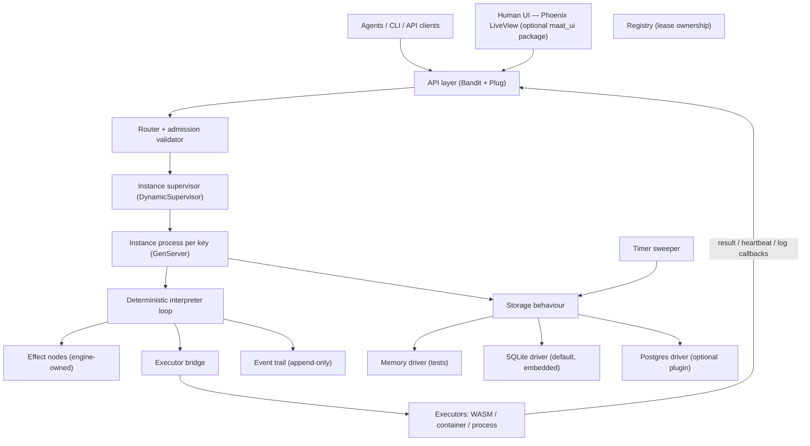
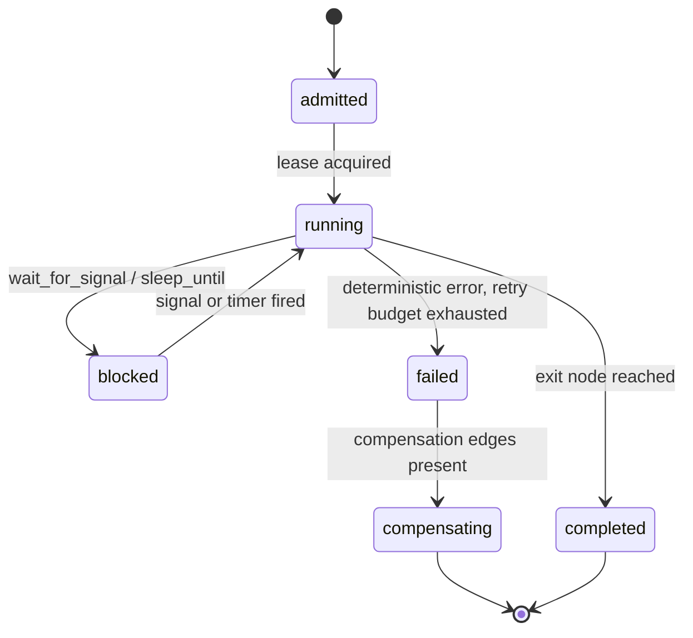

# Maat — Agent-Native Durable Execution Engine

**Status:** Draft v0.3 (2026-11-01: pre-M0 gap resolutions folded in, DECISIONS.md D-009–D-016; v0.2 added the optional LiveView UI package, D-007) · **Implementation language:** Elixir (OTP 27+, Elixir ≥ 1.20) · **Distribution:** single embedded library (`mix` dep) plus optional daemon plus optional human UI (`maat_ui` package)

> "Maat" is a working name (the Egyptian concept of truth/order — chosen for the fidelity principle at the core of this design). Rename freely. The name is not the product; the API is.

---

## 1. Summary

Maat is a durable execution engine for **agent-authored workflows**. It executes declarative workflow graphs reliably — surviving crashes, retrying failures, suspending for hours or days, and resuming without loss — while being:

- **Interpreter-over-data, not code-with-replay.** Workflows are declarative graphs (JSON). The engine is a deterministic interpreter over persisted state. There is no replay problem, because there is no program position to reconstruct — only state to read.
- **Decoupled from executed code.** Node code runs in external executors (WASM modules, containers, processes) reached over a thin invocation contract. The engine never links, imports, or executes agent code.
- **Storage-pluggable.** A narrow storage behaviour; embedded SQLite driver by default. No Postgres requirement. No Oban. No vendor products anywhere in the core.
- **Agent-facing.** Every observable is canonical, diffable JSON with stable diagnostic codes. The debugging interface is designed to be pasted into an LLM context window, sized to fit.
- **Human-facing too.** The same HTTP API serves people: an optional Phoenix LiveView UI package (`maat_ui`, milestone M4) plus the M3 CLI. The core library never depends on Phoenix.

The design stance is Kubernetes-like: **the API and its primitives are the product; the Elixir underneath is invisible to consumers.** Like Kubernetes via CRI, Maat does not know what a container or a WASM module is — it knows one invocation contract, and any substrate that honors it can execute nodes.

---

## 2. Design principles

These principles are normative. Design decisions below trace to them.

1. **Interpreter-over-data.** No workflow code runs inside the engine; only the graph is interpreted. Semantics live in schemas validated at admission, not in engine internals.
2. **State as data (fidelity).** All durable state is versioned, canonical JSON in the storage layer. Nothing load-bearing lives only in engine memory. The text of any resource must predict its behavior.
3. **Faithful absorption.** The engine absorbs delivery, retry, time, and resume — and never rewrites meaning. At-least-once everywhere; "exactly-once" is never claimed; idempotency keys are mandatory instead.
4. **Verified residue is schema, not code.** Graphs, node manifests, and instance state are JSON Schema-validated artifacts. Types are generated on both sides of every boundary (build-time codegen), so agents author against contracts, never engine APIs.
5. **Single-writer-per-key.** One lease-holder per instance at a time. No concurrent writers to reconcile; crash recovery is lease expiry; ordering is local.
6. **Closed primitive set.** Five resources. Resist primitive sprawl; everything else is a graph that *uses* the five.
7. **LLM-shaped observability.** `explain` output is canonical, token-budgeted JSON with stable codes, designed as an agent's primary debugging surface.
8. **No proprietary couplings.** Permissively licensed Elixir packages only; no vendor services required; no cloud dependency.

---

## 3. System architecture



**Components**

| Component | Responsibility |
|---|---|
| API layer | HTTP/JSON: resource CRUD, signals, callbacks (`result`/`heartbeat`/`log`), `explain`, `dry-run`, event trail reads |
| Human UI (optional package) | Phoenix LiveView app (`maat_ui`) that consumes the HTTP API for people; not part of the core library |
| Admission validator | JSON Schema validation + graph lint at submission; deterministic 3xxx rejections |
| Instance supervisor | One supervised GenServer per active instance key (lease-scoped lifecycle) |
| Interpreter | Pure decision function: `(graph, state, event) → (state', actions)`. No IO. Fully property-tested. |
| Effect nodes | Engine-owned primitives: `http`, `enqueue`, `sleep_until`, `wait_for_signal`, `emit`, `fail` |
| Executor bridge | Speaks the invocation contract to external executors; records attempts |
| Storage behaviour | `get/put/append/events/lease/subscribe/scan` — pluggable truth |
| Event trail | Append-only per-instance record; the audit log; feeds `explain` |
| Timer sweeper | Persists absolute deadlines; wakes instances (`Process.send_after` is a wake, never the truth) |

---

## 4. Primitive set (closed)

Five resources. Everything else is a graph that uses them.

### 4.1 GraphSpec

Declarative workflow definition, submitted as JSON, validated against `graph.schema.json`.

| Field | Type | Notes |
|---|---|---|
| `api_version` | string | `maat/v1alpha1` |
| `nodes` | map | node id → node definition (kind, inputs/outputs schema refs, retry policy, timeout, compensation ref) |
| `edges` | array | `{from, to, when?}` — `when` is a declarative predicate over node outputs |
| `entry` | string | entry node id |
| `compensation` | map | node id → compensation node id (optional per node); semantics in §5 |
| `max_state_bytes` | integer | optional, default 1048576 (1 MiB); state writes beyond the cap are rejected with 5003 |

**Content addressing:** the canonical JSON (sorted keys, no whitespace) is hashed (`sha256`). `graph_id = "b" <> hash`. The registry stores immutable versions; in-flight instances pin the version they started under; new instances bind to the newest matching spec. An instance always runs to completion on the version it was created under — mid-flight migration never happens automatically; an explicit migration API is deferred to M5 (`migrations.ex`). Graph upgrades therefore behave like schema migrations, because agents regenerate graphs the way they regenerate everything else.

**Admission lint (deterministic, fail-fast):** unknown node kinds, unreachable nodes, missing compensation for side-effecting nodes (manifest `side_effects`, default `true`) without `no_compensate: true`, compensation declared on a compensation node (3005), unresolvable schema refs, empty graphs, malformed predicates → rejected with 3xxx codes at submission, never at runtime.

### 4.2 Instance

One execution of a pinned graph version.

| Field | Type | Notes |
|---|---|---|
| `id` | string | caller-chosen or generated; namespaceable |
| `graph_id` + `version` | ref | pinned at creation |
| `status` | enum | `admitted`, `running`, `blocked`, `completed`, `failed`, `compensating` |
| `state` | JSON | per-node outputs + workflow variables; canonical JSON, schema-conformant |
| `blocked_on` | ref? | node + reason (`signal`, `timer`, `approval`) + since timestamp |
| `attempts` | map | node id → attempt ledger (see 4.5) |
| `version` | integer | optimistic-concurrency counter; fencing token |

### 4.3 Signal

A named, typed event delivered to a (possibly blocked) instance. Payload is schema-validated at delivery. `wait_for_signal` nodes complete on match; unmatched signals either buffer (declared `buffered: true`) or return 4xxx.

### 4.4 Timer

Absolute deadline (`RFC 3339`), persisted by the sweeper. Never a sleep: the engine persists *when*, and wakes *at*. Survives restarts, clock changes on the wall clock are irrelevant to already-persisted absolute times.

### 4.5 Invocation (attempt ledger entry)

One executor dispatch of one node.

| Field | Type | Notes |
|---|---|---|
| `attempt_id` | uuid | unique; the idempotency scope |
| `idempotency_key` | string | **mandatory**; stable across retries of a transport-unknown failure |
| `outcome` | enum | `unknown` (transport), `ok`, `deterministic_error`, `cancelled` |
| `error_code` | string? | stable code from the executor |
| `lease_expires_at` | ts | extended by heartbeats |

---

## 5. Execution semantics

**Instance lifecycle:**



- **Single-writer-per-key.** Exactly one process may hold an instance's lease. The mailbox of that GenServer *is* the event ordering for the instance — signals, timer wakes, and callbacks arrive in a single serialized queue.
- **Resume is a read.** After a crash, the supervisor restarts the instance process; it reads state, re-derives the next node, and continues. The interpreter is deterministic: same `(graph, state, event)` → same next action, always.
- **Retry policy is graph-declared, engine-enforced.** Per node: `max_attempts`, backoff (`constant | exponential`), jitter, budget. Executors never retry.
- **Two failure classes, never conflated:**
  - **Transport-unknown** (1xxx): the engine cannot know whether the node ran (invoke timeout, heartbeat lost, executor vanished). Retry **with the same idempotency key**; the node deduplicates.
  - **Deterministic** (2xxx): the node returned an error or violated its output schema. Retry per policy or traverse the failure/compensation edge.
- **Compensation (saga).** When a node fails deterministically and its retry budget is exhausted, the instance enters `compensating`. Compensation nodes run in reverse order of node completion (LIFO), are dispatched through the same executor contract with their own retry policy, and may not declare compensation themselves (3005 at admission). If a compensation node fails after its retries, the instance ends `failed`; the event trail and the instance state's `compensation` summary record the per-node outcome. Partial compensation is allowed and recorded.
- **Fencing.** All state writes are compare-and-swap on `version`. A lease-holder that died mid-flight and briefly resumes loses on the first write (`4001`), and its process terminates. Stale writers cannot corrupt state.

---

## 6. Executor contract

The entire integration surface between Maat and executed code. **Node code imports nothing.** A reference client library may exist for convenience, but the protocol is the contract (client-go vs. the K8s API).

### 6.1 Node manifest (registered per node kind)

```json
{
  "transport": "http | grpc | process",
  "input":  { "$ref": "schemas/resize_input.json" },
  "output": { "$ref": "schemas/resize_output.json" },
  "timeout_s": 300,
  "side_effects": true,
  "hints": { "kind": "wasm | container | shell", "size": "small" }
}
```

`hints` are informational for deployment tooling; the engine is indifferent to them. `side_effects` (default `true`) tells admission lint whether the node needs a compensation ref (3003); set `side_effects: false` for read-only nodes, or `no_compensate: true` to declare a deliberate uncompensated side effect.

### 6.2 Wire protocol

```
Engine → Executor
  invoke   {attempt_id, idempotency_key, input, deadline, graph_id, node_id}
  cancel   {attempt_id}            # best-effort

Executor → Engine (callbacks to the API)
  result   {attempt_id, ok | error, output, error_code?, metrics?}
  heartbeat{attempt_id, progress}          # extends invocation lease
  log      {attempt_id, line}               # JSON-lines; appended to the event trail
```

### 6.3 Obligations (the guarantee split)

**Engine guarantees:** invoke delivery at-least-once; result recording exactly-once per `attempt_id`; retry policy enforcement; deadline enforcement; persisted audit trail of every attempt.

**Executor guarantees:** idempotent behavior under a repeated `idempotency_key`; its own side effects are its own concern (the engine guarantees delivery, not transactionality around what the node does); output schema conformance; best-effort cancel and deadline respect; heartbeats if long-running.

**Substrate independence:** WASM modules, containers, shell one-liners, or any HTTP service — anything that honors the contract. The engine never links agent code, so node logic (including prompt-injected logic) can structurally never touch engine state.

---

## 7. Engine-owned effect nodes

These are interpreter-native; they are not dispatched to executors.

| Node kind | Semantics |
|---|---|
| `http` | Outbound call with mandatory idempotency key, declared retry budget, timeout |
| `enqueue` | Create a child instance (declared graph ref); parent blocks on child completion or proceeds (declared) |
| `sleep_until` | Persist absolute deadline → wake |
| `wait_for_signal` | Block on a named signal; optional match predicate and timeout edge |
| `emit` | Append an event to the trail (notifications, audit) |
| `fail` | Deterministic failure edge (saga control) |

Compute nodes — the agent-authored pure functions — are declared in the graph like any other node and dispatched via the executor contract. The closed set rule: adding more node kinds requires a version bump of the graph schema, and additions should be rare and small.

---

## 8. Storage interface

A single Elixir behaviour. Drivers are the only pluggable-truth surface.

```elixir
defmodule Maat.Storage do
  @callback get(ns, key) :: {:ok, {value :: term, version :: integer}} | :not_found
  @callback put(ns, key, value, expected_version :: integer) :: :ok | {:conflict, current :: integer}
  @callback append(ns, key, event :: map) :: :ok
  @callback events(ns, key, opts) :: [map]           # reverse-chron available
  @callback lease(ns, key, ttl_ms) :: {:ok, lease} | {:taken, holder}
  @callback renew(lease, ttl_ms) :: :ok | {:lost, current_holder}
  @callback subscribe(ns, prefix) :: :ok
  @callback scan(prefix, since) :: [entry]             # incl. :timers_due
end
```

**Semantics (must hold for every driver, including a future Ra-backed one):** leases carry a fencing token; every mutation is compare-and-swap on `version`; change notification is derived from the event trail via `scan` (`subscribe` is a best-effort hint, never load-bearing). The memory driver implements real fencing-token leases so the property suites exercise these semantics from M0.

**Drivers:**

| Driver | Status | Role |
|---|---|---|
| `Maat.Storage.Memory` | v1, core | Tests, property suites, embedded single-run use |
| `Maat.Storage.Sqlite` | v1, default | Embedded production driver (Ecto + ecto_sqlite3/exqlite); WAL mode; single file |
| `Maat.Storage.Postgres` | plugin, later | Same behaviour, separate (optional) package — satisfies "not locked" by being not required, not bundled, and not imported by core |
| `Maat.Storage.Ra` | later | Embedded multi-node replication via Ra (replicated log, same interface) |

DDL belongs to each driver's migrations. The core never composes SQL.

**Explicitly excluded from the core:** Oban (job scheduling is the sweeper + interpreter, not a job system), any queue product, any vendor SDK, any cloud client.

---

## 9. API & agent observability

### 9.1 HTTP API (Bandit + Plug; JSON in, JSON out)

- `GET/PUT /v1/graphs`, `GET /v1/graphs/{id}/versions`
- `POST /v1/instances`, `GET /v1/instances/{id}`, `GET /v1/instances?status=blocked&prefix=orders`
- `POST /v1/instances/{id}/signals`
- `POST /v1/callbacks/result | heartbeat | log` (executor callbacks; require a bearer token issued per executor registration — stored only as a SHA-256 hash, scoped to the node kinds the executor serves, rotatable via the API; required even on localhost)
- `GET /v1/instances/{id}/explain`
- `POST /v1/instances/{id}/dry-run`
- `GET /v1/instances/{id}/events?last=50`

### 9.2 `explain` — the agent's debugging surface

Output requirements: canonical JSON, sorted keys, token-budgeted (soft cap ~6 KB; tail-truncate logs with counts), stable codes, and **self-contained** — a reader with no other context can act on it.

```json
{
  "id": "order-4711",
  "graph": {"id": "b9f2…", "version": 3, "entry": "validate"},
  "status": "blocked",
  "blocked_on": {"node": "wait_approval", "reason": "signal", "since": "2026-11-01T09:14:22Z"},
  "state_digest": {"completed": ["validate", "reserve"], "vars": {"amount": 4200}},
  "last_errors": [
    {"node": "charge", "code": "1002", "message": "heartbeat lost", "at": "2026-11-01T09:12:03Z"}
  ],
  "next": {"node": "wait_approval", "action": "resume_on_signal", "signal": "approved"},
  "suggestions": ["signal approved=true", "cancel --reason manual"]
}
```

### 9.3 `dry-run`

Evaluates the interpreter over current state with a proposed event, without mutating: returns the exact next node, the actions the engine *would* take, and any schema or policy violations. Deterministic by construction (the interpreter is pure). Cost is bounded because instance state is capped by the graph's `max_state_bytes` (default 1 MiB; writes beyond the cap are rejected with 5003).

### 9.4 Canonical JSON rules (normative)

Sorted keys; UTF-8; numbers are integers or decimal strings (e.g. `"4.20"`) — floats are rejected at admission and during canonicalization, and currency is declared in the schema; timestamps are RFC 3339 strings; no binary blobs (out-of-band refs); state writes compare on `version`; diffs are JSON Patches.

### 9.5 Diagnostic codes (stable, versioned, closed additions only)

| Range | Class | Examples |
|---|---|---|
| 0xxx | success | `0001 ok` |
| 1xxx | transport-unknown outcome | `1001 invoke timeout`, `1002 heartbeat lost`, `1003 executor vanished` |
| 2xxx | deterministic node failure | `2001 node error`, `2002 output schema violation`, `2003 deadline exceeded by node` |
| 3xxx | admission/graph | `3001 invalid graph`, `3002 unknown node kind`, `3003 missing compensation`, `3004 unreachable node`, `3005 compensation of compensation` |
| 4xxx | state/concurrency | `4001 version conflict (fenced)`, `4002 lease lost`, `4003 instance terminal` |
| 5xxx | engine internal | `5001 storage error`, `5002 driver unavailable`, `5003 state exceeds max_state_bytes` |

Codes are part of the public API: agents may branch on them; they are never reordered or renumbered.

---

## 10. Failure model

| Failure | Response |
|---|---|
| Interpreter process crash | Supervisor restarts process; state re-read from storage; next step re-derived (idempotent — deterministic interpreter) |
| Lease-holder dies | Lease expires; another holder acquires; old holder fenced by `version` on its next write (4001) |
| Executor death / silent | Heartbeat loss → attempt marked `unknown` (1xxx) → retry, same idempotency key |
| Node returns bad output | 2002 at admission of result; deterministic path |
| Storage failure | Attempt rolled back; 5xxx surfaced; instance process halts (no speculative state) |
| Whole-node crash | SQLite WAL recovery; on boot, sweeper scans for `timers_due` and orphans; instances resume |

---

## 11. Testing strategy

The engine's own perception layer; it eats its own dogfood.

1. **Convergence property (StreamData):** for any interleaving of crash, resume, signal, timer, and callback events — the instance converges to a terminal state and all declared invariants hold. Fake clock; memory driver with kill switches (crash injection points).
2. **Determinism property:** same `(graph, state, event)` → byte-identical decision output, across many random states.
3. **Fencing property:** a zombie writer can never commit; property-tested with artificial version skew.
4. **Timer durability:** absolute deadlines fire correctly across simulated restarts and clock jitter.
5. **Canonicalization round-trips:** arbitrary state JSON → canonical form → parse → identical.
6. **Golden state snapshots:** canonical JSON state after each step, diffed in CI — workflow behavior reviews become diff reviews.
7. **Executor conformance suite (shipped as a library):** run against *any* node implementation to verify: valid manifest, input/output schema conformance, idempotency under repeated `invoke` with one key, deadline respect, heartbeat behavior. This is the loop agent-authored nodes run in — no engine required.

---

## 12. Project structure

```
maat/
  mix.exs                  # core: engine + behaviour + memory & sqlite drivers
  lib/maat/
    api/                   # Bandit/Plug router, callbacks, canonical encoder
    engine/
      interpreter.ex       # pure decision function
      instance.ex           # GenServer per key
      lease.ex              # fencing leases
      sweeper.ex
      effects/              # http, enqueue, sleep_until, wait_for_signal, emit, fail
      bridge.ex             # executor invocation
    graph/
      admission.ex          # schema validation + lint (3xxx)
      registry.ex           # content-addressed specs
      migrations.ex         # state-shape migration functions (pure, tested)
    storage/
      behaviour.ex
      memory.ex
      sqlite.ex
  schemas/                  # graph.schema.json, manifest.schema.json, codes.json — the contract layer
  test/                     # StreamData suites + conformance suite
maat_postgres/              # separate package, later
maat_ra/                    # separate package, later
maat_ui/                    # optional package: Phoenix LiveView UI for humans, consumes the HTTP API
```

Elixir ≥ 1.20 (gradual set-theoretic typing active in the compiler — inference over the whole codebase, no annotations required; the interpreter is the strictest-checked module). OTP 27+. Only permissively licensed dependencies:

| Package | License* | Role |
|---|---|---|
| Bandit | MIT | Pure-Elixir HTTP server (no cgo) |
| Plug | Apache-2.0 | Request abstraction |
| Jason | Apache-2.0 | JSON |
| Ecto | Apache-2.0 | Storage/query toolbox for the SQLite driver (not Postgres-bound) |
| ecto_sqlite3 + exqlite | Apache-2.0/MIT | Embedded SQLite driver, WAL |
| StreamData | Apache-2.0 | Property testing |
| NimbleOptions | Apache-2.0 | Config validation |
| ExJsonSchema | MIT | Admission-time schema validation |
| Req | MIT | The engine's own `http` effect node (outbound) |
| Phoenix | MIT | *Optional `maat_ui` package only* — web framework for the human UI; never a core dependency |
| Phoenix.LiveView | MIT | *Optional `maat_ui` package only* — real-time human UI over the API; never a core dependency |
| Ra | Apache-2.0 | *Future phase only* — embedded replicated log for multi-node |

\* Licenses to be re-verified at adoption; additions must remain permissive (Apache-2.0/MIT/MPL) and dependency-free of vendor services.

**Excluded by design:** Oban, Postgres as a requirement, Temporal/Restate anything, vendor clouds, SDK-requiring executors.

---

## 13. Milestones

| Milestone | Contents | Exit criterion |
|---|---|---|
| **M0 — Core semantics** | Schemas; memory driver; interpreter; fake clock; admission lint; convergence + determinism properties | All StreamData suites green on crash-injected runs |
| **M1 — Durable** | SQLite driver; event trail; leases + fencing; sweeper; restart recovery | Kill -9 at random points; instances resume; no state divergence |
| **M2 — Executable** | Executor bridge; HTTP transport; reference executor; conformance suite; callbacks API | Conformance suite passes for wasm + container + process substrates |
| **M3 — Agent surface** | `explain`, `dry-run`, diagnostic codes, query API, CLI (escript wrapping the API) | Explain output consumed cold by a frontier model resolves a stuck workflow |
| **M4 — Human surface** | `maat_ui` package: Phoenix LiveView UI over the HTTP API (graph list/versions, instance detail, signals, event trail, `explain` view, dry-run) | A human can watch and nudge a stuck workflow without an agent |
| **M5 — Later, optional** | Postgres driver package; Ra replication; graph state migrations v1 | Interface unchanged; drivers swapped; no core edits |

---

## 14. Non-goals

- **No UI in the core library.** The engine ships JSON/API only and stays embeddable with zero web dependencies. Humans get a first-party optional LiveView UI (`maat_ui`, M4) that consumes the API like any other client.
- **No code-as-workflow.** No SDK you import, no replay, no deterministic-workflow discipline — impossible by construction instead.
- **No exactly-once claims.** At-least-once + mandatory idempotency keys, stated as obligations.
- **No bundled job queue, no Oban-shaped features.** If you need a queue, build one as a graph.
- **No multi-language graph DSLs** beyond JSON Schema.
- **No vendor coupling of any kind.** The engine must run from `mix` with zero external services and a single data file.